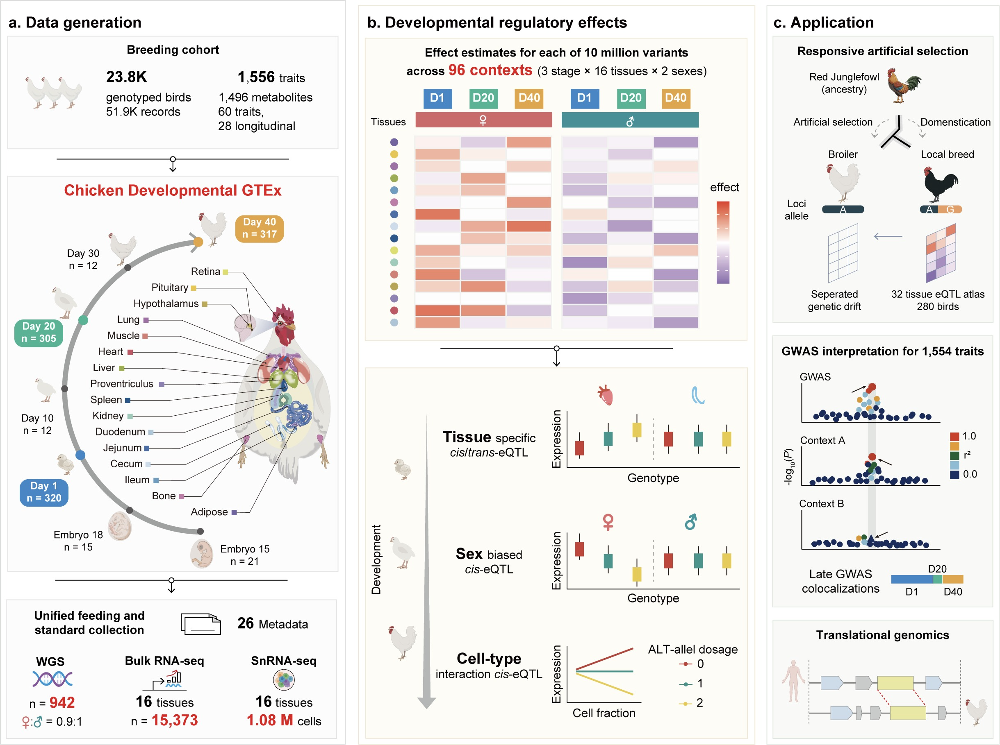

Analysis pipelines for the pilot phase (V0) of Chicken dGTEx

1. Introduction
As an essential component of the ongoing Farm animal Genotype-Tissue Expression (FarmGTEx, https://www.farmgtex.org/), the Chicken Developmental GTEx (cdGTEx) aims to establish a comprehensive public catalogue of genetic regulatory variants across diverse biological contexts (e.g., tissues, developmental stages, sex, and genetic backgrounds) in chickens. This resource will serve as a foundational reference for understanding the genetic regulation of basic biological processes and complex traits. It will also support research in comparative transcriptomics, livestock evolution and domestication, precision breeding, sustainable agriculture, and human biomedicine.

2. Analysis pipelines
This repository contains code used in data analysis of the cdGTEx pilot phase, including:
01. WGS_process: whole-genome sequencing read processing, alignment, variant calling, joint genotyping, quality control, and population structure analysis.
02. RNA_process: RNA-seq alignment and gene-level quantification, followed by expression normalization.
03. Sample_swap_detection: detection of sample swaps and identity mismatches by comparing RNA-seq-derived genotypes with matched whole-genome genotypes.
04. Metadata_prediction: prediction of sample metadata from transcriptomic profiles using supervised machine-learning classifiers.
05. Gene_expression_analyses: gene expression variance decomposition, sample clustering, weighted gene co-expression network analysis, and period-, sex-, and tissue-specific expression analyses.
06. MolQTL_mapping: molecular quantitative trait locus (molQTL) discovery, annotation and validation.
07. MolQTL_validation: cross-stage replication of molQTL associations and allele-specific expression–based validation of cis-eQTL effect sizes and directions.
08. MolQTL_mapping_by_context: identification of sex-dependent cis-regulatory effects using genotype-by-sex interaction models.
09. Mashr: analysis of molQTL sharing across tissues or stages.
10. Mediation: mediation analysis of relationships between genotype and gene expression through candidate cellular, co-expression module, transcription factor, or hormonal mediators.
11. Context_specific_molQTL_analysis: analysis tissue-, stage-, or sex-specific regulatory effects and their dynamic changes.
12. Population_genetics: identification of lineage-specific selection (LSBL) and functional characterization of selected variants.
13. GWAS_and_molQTL: GWAS, Colocalization, SMR, and TWAS.
